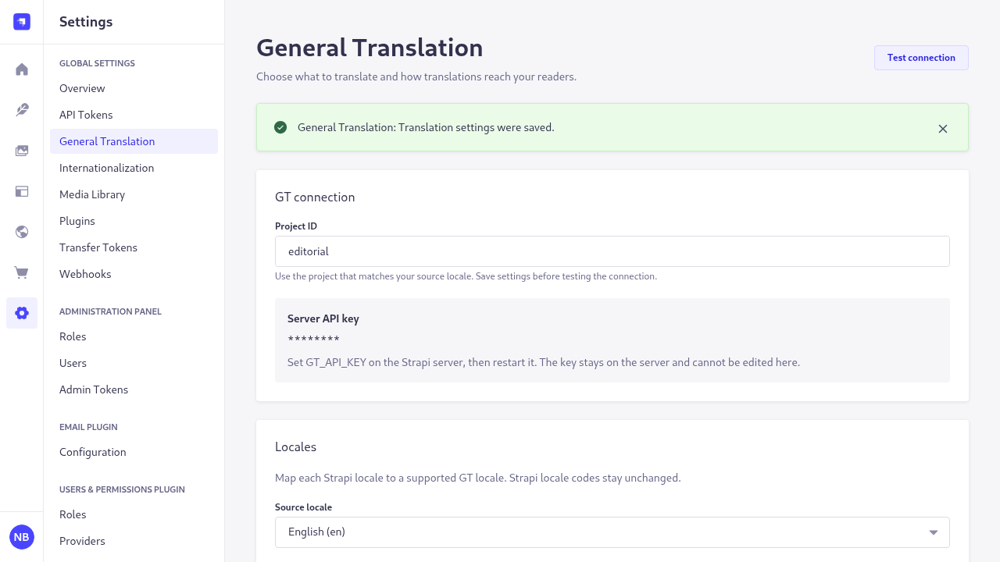

# General Translation for Strapi

## What it does

This community plugin translates selected localized Strapi fields through your General Translation account.
Editors translate one entry or a selection, review per-locale jobs, and preserve human changes unless they explicitly force a replacement.

## Screenshots

General Translation settings in the real Strapi playground:



The Ender Post example reads published articles from Strapi:


Both images were captured with Playwright from the running local applications.

## Compatibility

| Component       | Supported target                     | Verification                                  |
| --------------- | ------------------------------------ | --------------------------------------------- |
| Strapi          | 5.57.x                               | Real app and tarball consumer on 5.57.0       |
| Node.js         | Node 22 from 22.12, Node 24, Node 26 | Local runs on pinned 24.21.0                  |
| Package manager | Source workspace: pnpm 12.11.2       | Install, build and local packing              |
| SQLite          | 3                                    | Real integration and fresh tarball app        |
| PostgreSQL      | 14 or later                          | Real translation and publication tests on 17  |
| MySQL           | 8.0 or later                         | Real translation and publication tests on 8.4 |

Strapi's [installation requirements](https://docs.strapi.io/cms/installation/cli)
list the supported Node LTS releases and database versions. Internationalization
must be enabled on each content type you want to translate. Older Strapi minors
and Strapi 4 are outside this package's support range.

## Install

The package is currently unpublished. Build a local archive from this source
checkout using the versions in `mise.toml`. From the checkout root:

```sh
node --version
pnpm --version
pnpm install --frozen-lockfile
pnpm --filter strapi-plugin-general-translation build
pnpm --filter strapi-plugin-general-translation verify
pnpm --filter strapi-plugin-general-translation pack --pack-destination .work/packages
```

The pack command prints the archive path; its filename contains the version in
`packages/plugin/package.json`. Copy that archive into your Strapi 5.57 app's root
and name the copy `strapi-plugin-general-translation.tgz`. From that app's root:

```sh
pnpm add ./strapi-plugin-general-translation.tgz
pnpm build
pnpm start
```

Set the environment variables below before the final start. Installing the package
registers the plugin; rebuilding includes its admin interface. Open Settings,
then General Translation. For the local Enderman examples, see the
[example guide](docs/examples.md), which covers mock mode and live GT mode.

## Configuration

| Variable        | Where it belongs          | Purpose                                                            |
| --------------- | ------------------------- | ------------------------------------------------------------------ |
| `GT_API_KEY`    | Strapi server environment | Required GT credential; restart Strapi after changing it           |
| `GT_PROJECT_ID` | Strapi server environment | Initial project default; a saved admin project ID takes precedence |

The key stays on the server. Settings show only whether it is present and a masked
marker; there is no key input or stored-key fallback. Use a GT project whose source
locale matches Strapi. The plugin interface includes English, Spanish, French and
Arabic labels, following the selected Strapi admin language.

In Settings, General Translation:

1. Enter the project ID, choose the source locale and select installed target locales.
2. Map Strapi codes to supported GT locales where necessary. Strapi's codes do not change.
3. Select localized content types and fields. Add context for ambiguous terms or an editorial tone.
4. Choose whether missing target locales may be created. Leave automatic publishing and automatic translation off for a review-first workflow.
5. Save settings, then choose Test connection.

A connection check proves project access, not every translation permission. See
[operations](docs/operations.md) for key scopes and retry behavior. Manage Context
Groups and glossaries in the GT dashboard and assign them to this project; the
plugin does not administer organization context.

## Usage

For one entry, save the source document, open More document actions and choose
Translate, or use the Translation panel. Choose target locales and submit. Unsaved
changes are not translated. The panel and Job history show progress and the latest
result for each locale.

For a collection, select saved entries in Content Manager and choose Translate
selected. Each document and target locale has a separate job and result.

Automatic translation is off by default. Choose On source save or On source
publish in settings to queue work after a successful source operation by an
authenticated admin editor. It uses that editor's current permissions. Content API
requests, API tokens and background scripts do not trigger automatic translation.

Translations become drafts when Draft and Publish is enabled, unless automatic
publishing is selected and permitted. Without Draft and Publish, a saved
translation is immediately visible. Creating a missing target locale is separately
controlled and still needs create permission.

The plugin sends changed source fields and protects human changes in the target,
including existing text without machine history. Review the target before using
Force retranslate and its acknowledgement. Force can replace human text but cannot
apply a source snapshot or target state that changed while the job was running.

## Field handling

| Field                                                      | Behavior                                                                                            |
| ---------------------------------------------------------- | --------------------------------------------------------------------------------------------------- |
| Localized string and text                                  | Translate selected fields; selected by default                                                      |
| Rich text in Markdown                                      | Translate prose while retaining syntax, links and code; reject structural changes                   |
| Blocks                                                     | Translate text leaves while retaining nodes, marks, links and layout                                |
| Components and repeatable components                       | Walk configured localized text recursively                                                          |
| Dynamic zones                                              | Preserve component kinds and ordering while translating eligible text                               |
| UID or slug                                                | Opt in to copy the source or regenerate from a selected translated field                            |
| Media alt text and caption                                 | Opt-in overrides per document, occurrence and locale; shared Media Library metadata stays unchanged |
| Media binary                                               | Never sent for translation                                                                          |
| Relations                                                  | Never translated or remapped to another locale by this plugin                                       |
| Numbers, booleans, dates, times, enums, JSON and passwords | Never sent for translation                                                                          |
| Private or nonlocalized fields                             | Excluded                                                                                            |

Regenerated UIDs transliterate the target title to ASCII. A nonempty title without
an ASCII transliteration gets a stable `entry-` hash bound to its document and
field. Empty titles are rejected. Strapi still validates uniqueness when publishing;
duplicate readable slugs may need an editor change.

Existing target relations are preserved. A newly created locale may have no
category or related-entry links; assign those separately in Content Manager.

Edit localized media metadata in the Translation panel. Published Content API GET
responses include valid overrides for populated media. Other delivery paths need
explicit validation; see [localized media metadata](docs/media.md).

## Permissions

Assign these plugin permissions to the editor's admin role:

| Permission                | Access                                                     |
| ------------------------- | ---------------------------------------------------------- |
| Read settings             | View configuration and test the saved connection           |
| Change settings           | Save plugin configuration                                  |
| Translate an entry        | Queue a single entry and edit its localized media metadata |
| Translate entries in bulk | Queue a selection of entries                               |

Translation also needs read access to the source and create or update access to
the target's content type, locale and affected fields. Publication needs publish
permission. Queued work rechecks the initiating editor's current access before
writing; a role change can stop it. A translator does not need settings access just
to use the translation panel. Public Content API roles do not grant admin plugin
access.

## GT usage and billing

Translations are billed to your own GT organization. The plugin does not include
GT credits or a separate translation allowance. Input size, workflow, context and
number of targets affect usage; forced retranslation and repeated paid requests
can add charges.

Small batches and contextual fields use runtime translation. Large context-free
batches use JSON file translation, which has a different rate. Check
[GT usage rates](https://generaltranslation.com/en-US/pricing/usage) and your
account's limits before enabling automatic work. There is no guaranteed
per-document price.

## Strapi AI Translations

The plugin warns when Strapi's built-in AI Translations are enabled and refuses
to enable its own automatic mode alongside them. Disable one automatic writer
before continuing. Strapi's writer does not use this plugin's human-edit history
and can replace target changes later, even after a manual GT translation. See
[Strapi internationalization](https://docs.strapi.io/cms/features/internationalization)
for its plan requirements and behavior.

## Set up with a coding agent

Copy this instruction into your coding agent after giving it the source checkout
and your Strapi app:

```text
Install the locally packed strapi-plugin-general-translation package in this
Strapi 5.57 app. It is currently unpublished; do not install a similarly named
registry package. Use the checkout's pinned toolchain to build and verify it.
Set GT_API_KEY in the Strapi server environment without printing or committing it.
Set GT_PROJECT_ID or save the project ID in General Translation settings.
Rebuild the admin and restart the app. Configure the source and target locales,
select localized fields, save and test the connection. Translate one saved source
entry. Verify its job result and target draft, confirm the draft is absent from
published reads, then publish with an authorized editor and verify the frontend.
Check a human target edit and a denied locale before enabling automatic jobs.
Do not publish the plugin or change remote configuration.
```

## Known limitations

- The package is a local, unpublished integration. The compatibility table does
  not claim support for older Strapi minors or untested custom delivery paths.
- Contextual fields use the runtime path, including large ones. The file path is
  limited to context-free batches; it does not discard context to fit a threshold.
- Automatic jobs need an authenticated admin operation. There is no implicit
  service account for content API or background writes.
- Localized media overrides apply to normal populated REST reads through the
  Document Service. They do not make the global Media Library, GraphQL or custom
  database readers locale-aware.
- The Enderman example has separate mock and live modes. Mock translations are
  marked for repeatable testing and do not demonstrate language quality. Live mode
  uses your GT account; review translated stories before publishing them.
- Strapi 5.57's native media carousel has an invalid `aria-selected` attribute on
  a group, and its read-only content list can have an unfocusable scroll region.
  Plugin settings and history have whole-page accessibility checks. Native editor
  checks cover plugin panels and dialogs with all rules enabled.
- PostgreSQL with `pg` 8.23 can report a concurrent-query deprecation during
  Strapi's dynamic-zone writes. The PostgreSQL translation and publication tests
  pass, but this upstream warning remains.
- The formatting playground demonstrates nine GT formatters and locale helpers.
  Its exchange example multiplies by a visible sample rate; GT formats the result
  and does not fetch rates or convert currencies. See [the example guide](docs/examples.md).

## Troubleshooting

| Symptom                                     | Next step                                                                                                     |
| ------------------------------------------- | ------------------------------------------------------------------------------------------------------------- |
| Key not configured or invalid               | Set `GT_API_KEY` on the Strapi server and restart it; check the key's project access                          |
| Connection passes but translation is denied | Check runtime and file permissions on the key and the editor's Strapi permissions                             |
| Unsupported locale                          | Map the installed Strapi locale to a supported GT locale in settings                                          |
| Quota or credit error                       | Review GT billing and limits, then retry after correcting them                                                |
| Needs review                                | Inspect current source and target text; do not force a replacement without reviewing human edits              |
| Missing target                              | Enable Create missing target locales and grant create access, or create the locale manually                   |
| Translation absent from the reader          | Publish the target locale and verify the frontend requests that locale with published status                  |
| Source changed on media                     | Review the shared asset or structure change, then retranslate the localized metadata                          |
| Request outcome uncertain                   | The job stops for review. Check GT activity before acknowledging a retry; another paid request may be created |

Jobs and confirmed runtime chunks survive an ordinary server restart in Strapi's
database. Unknown paid-request outcomes need review before retry. Job history
records failures instead of treating empty or partial GT output as success. Read
[operations](docs/operations.md) before retrying an interrupted job.

## Security

Keep the API key in the Strapi server environment or deployment secret store. Never
use `STRAPI_ADMIN_` or `NEXT_PUBLIC_` prefixes for it. Do not commit `.env`, put keys
in MCP configuration, paste them into screenshots or log provider responses.

Only selected translation text and configured context are sent to GT. Decide which
content your organization permits GT to process. The Next example reads Strapi on
the server; an optional Strapi read token stays there. The seeded playground grants
public reads to its example articles and categories; review those permissions
before adapting it for other content.

## Contributing

Read [CONTRIBUTING.md](CONTRIBUTING.md) for worktrees, behavior tests, checks,
agent setup and the release boundary. Follow [the writing style](docs/writing-style.md).
Record research and verification in ignored `.work/`; include only product,
tooling and contributor documentation in commits.

## License and affiliation

[MIT](LICENSE). This is an independent community integration, not an official
product of or endorsed by General Translation or Strapi. The example fan zine is
unofficial and is not affiliated with Mojang or Microsoft.
